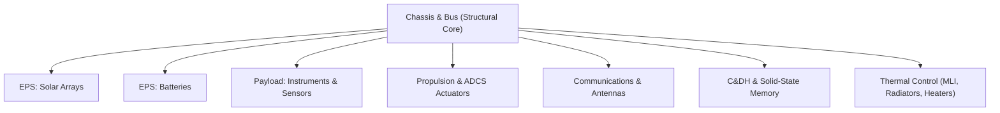

# 🛰️ Satellite Components & Equipment Catalog Specification
## Document: `COMPONENTS_SPEC.md`
**Project:** 3D Low Earth Orbit Satellite Design & Simulation Game  
**Status:** Approved Architectural Standard  

---

## 1. Executive Summary & Design Decisions

This document formalizes the equipment catalog, subsystem classifications, attribute schemas, and physical constraints governing modular satellite assembly.

### Key Architectural Decisions
1. **Modular Slot-Unit / Grid Architecture**:
   - Replaces monolithic, fixed-slot chassis configurations with a flexible unit-grid system.
   - Satellites possess **Internal Slots** (measured in standard Form-Factor Units / CubeSat Us) for avionics, batteries, tanks, and SSRs, and **External Mounting Faces** (Surface mount zones) for solar arrays, antennas, sensor apertures, radiator plates, and thruster nozzles.
   - Subsystem balances prevent game-breaking configurations (e.g. mass, center-of-mass offsets, and thermal accumulation scale with component density).

2. **Deterministic Hardware Operation**:
   - Hardware does **not** rely on probabilistic RNG breakdowns (no random MTBF rolls).
   - All component performance, survival, and mission success are strictly **deterministic**: as long as the satellite stays within physical boundaries (positive power balance, battery Depth of Discharge limits, temperature limits $[-40^\circ\text{C}, +65^\circ\text{C}]$, and positive propellant reserves), components function at 100% rated efficiency.

3. **Hybrid "Ghost Primitive" 3D Visual Architecture**:
   - **Wrapper Object (Three.js Primitive)**: Invisible or semi-transparent wireframe Three.js geometry (`BoxGeometry`, `CylinderGeometry`) that handles math, oriented bounding boxes (OBB), slot snapping, raycasting, and center-of-mass calculations.
   - **Visual Child (glTF / GLB Asset)**: High-fidelity 3D model loaded asynchronously as a child of the primitive wrapper.
   - **Graceful Fallback**: If a 3D model asset is loading, unassigned, or missing, the primitive renders with clean PBR materials (metallic/roughness) so the game remains 100% playable without external 3D files.

---

## 2. Modular Slot-Unit & Grid Hierarchy

Every chassis provides both **Internal Grid Slots** and **External Mounting Faces**:

```
+-------------------------------------------------------+
|                 EXTERNAL MOUNT: TOP                   |
|           (Antenna / Sensor Aperture / TCS)           |
+-------------------------------------------------------+
|  INTERNAL SLOT 1 (1U)   |   INTERNAL SLOT 2 (1U)      |
|  [OBC / C&DH Unit]      |   [Li-ion Battery 50Wh]     |
+-------------------------+-----------------------------+
|  INTERNAL SLOT 3 (1U)   |   INTERNAL SLOT 4 (1U)      |
|  [Cold Gas Prop Tank]   |   [High-Res Optical Imager] |
+-------------------------------------------------------+
|                 EXTERNAL MOUNT: BOTTOM                |
|             (Thruster Nozzle / Ground Comms)          |
+-------------------------------------------------------+
|  EXT. FACE: PORT (+X)   |   EXT. FACE: STBD (-X)      |
|  [Deployable Solar 30W] |   [Deployable Solar 30W]    |
+-------------------------+-----------------------------+
```

### Chassis Size Specifications

| Chassis Class | Form Factor | Internal Slots ($U$) | External Mount Faces | Max Dry Mass ($kg$) | Base Hull Drag Area ($m^2$) |
| :--- | :--- | :--- | :--- | :--- | :--- |
| **1U CubeSat** | $10 \times 10 \times 10\text{ cm}$ | $1\text{ U}$ | 6 faces | $2.0\text{ kg}$ | $0.010\text{ m}^2$ |
| **3U CubeSat** | $10 \times 10 \times 30\text{ cm}$ | $3\text{ U}$ | 6 faces (extended lateral) | $6.0\text{ kg}$ | $0.030\text{ m}^2$ |
| **6U CubeSat** | $10 \times 20 \times 30\text{ cm}$ | $6\text{ U}$ | 6 faces (double-width) | $14.0\text{ kg}$ | $0.060\text{ m}^2$ |
| **SmallSat Bus** | $60 \times 60 \times 80\text{ cm}$ | $16\text{ U}$-equivalent | 8 payload & equipment bays | $180.0\text{ kg}$ | $0.480\text{ m}^2$ |
| **Heavy LEO Bus**| $120 \times 120 \times 150\text{ cm}$| $48\text{ U}$-equivalent | 12 modular payload bays | $800.0\text{ kg}$ | $1.800\text{ m}^2$ |

---

## 3. Subsystem Classifications & Attributes

The catalog divides equipment into **8 distinct functional categories**:



---

### 3.1 Universal Component Schema

Every catalog entry in `server/data/components.json` adheres to this standard interface:

```typescript
interface BaseComponent {
  id: string;                     // Unique identifier (e.g., "eps_solar_gaas_deploy_30w")
  name: string;                   // Display name
  category: ComponentCategory;    // "bus" | "eps_solar" | "eps_battery" | "payload" | 
                                  // "propulsion" | "comms" | "cdh" | "tcs"
  tier: 1 | 2 | 3;               // Tech progression tier
  costUSD: number;                // Procurement cost ($)
  massKg: number;                 // Component mass (kg)
  slotRequirement: {
    type: "internal" | "external";
    sizeUnits: number;            // 1 = 1U slot, 2 = 2U volume, etc.
    mountZone?: "face_top" | "face_bottom" | "face_side" | "internal_bay";
  };
  chassisCompatibility: string[]; // ["1u", "3u", "6u", "smallsat", "heavy"]
  standbyPowerW: number;          // Passive power draw when satellite is idle (W)
  operationalPowerW: number;      // Active power draw during operation (W)
  heatDissipationW: number;       // Thermal output into satellite core (W)
  techRequired: string;           // Tech tree node required to unlock
  description: string;            // Aerospace engineering description
  
  // Three.js Ghost Primitive & 3D Visual Definition
  visual: {
    ghostPrimitive: {
      type: "box" | "cylinder" | "plane";
      dimensions: [number, number, number]; // [width/radius, height, depth] in meters
      offset: [number, number, number];     // Local translation relative to socket
      color: string;                        // Fallback PBR hex color (e.g., "#1A2238")
      metalness: number;                    // 0.0 to 1.0
      roughness: number;                    // 0.0 to 1.0
      wireframeColor?: string;              // Color when selected/snapping
    };
    modelAsset?: {
      gltfPath: string;                     // e.g., "/assets/models/solar_array_3u.glb"
      scale: [number, number, number];
      rotation: [number, number, number];
    };
  };
}
```

---

## 4. Subsystem Specifications & Metrics

### 4.1 Electrical Power System — Solar (`eps_solar`)
Generates electrical power when the satellite is outside Earth's shadow ($P_{generation} = P_{sun} \times \cos(\theta_{sun})$).

* **Specific Attributes**:
  * `powerSunW` ($W$): Nominal power output at normal solar incidence ($1\text{ AU}$, $\approx 1361\text{ W/m}^2$).
  * `sunTracking`: `boolean`. If true, automatically rotates to face the Sun vector.
  * `deployedDragAreaM2` ($m^2$): Additional cross-sectional drag area added to the satellite once deployed.
* **Component Spectrum**:
  * *Body-Mounted Silicon Cells (1U/3U)*: Low power (3W–12W), 0 drag increase, 0 moving parts.
  * *Deployable Silicon Panels (3U/6U)*: Mid power (20W–45W), moderate drag, occupies side mounts.
  * *Articulated Dual-Wing GaAs Arrays (SmallSat/Heavy)*: High power (120W–1200W), active solar tracking, high drag area.

---

### 4.2 Electrical Power System — Battery (`eps_battery`)
Stores energy harvested in sunlight to sustain the satellite throughout orbital night/eclipse.

* **Specific Attributes**:
  * `capacityWh` ($Wh$): Total electrical energy capacity.
  * `maxDoD`: Maximum Depth of Discharge (e.g. `0.80` = 80%). Sustained discharge deeper than this trips emergency Safe Mode.
  * `maxDischargeRateW` ($W$): Maximum instantaneous current output before voltage drop.
* **Component Spectrum**:
  * *Li-Ion CubeSat Pack*: 20Wh to 80Wh, high energy density, compact 1U form factor.
  * *Aerospace Solid-State Pack*: 250Wh to 2,000Wh, high thermal resistance, large capacity for radar and high-duty payloads.

---

### 4.3 Scientific Payloads & Instruments (`payload`)
Mission-critical gear required to complete contracts and generate telemetry data.

* **Specific Attributes**:
  * `payloadType`: `"optical"` | `"sar"` | `"spectrometer"` | `"iot_relay"`
  * `dataGenerationMBPerOrbit` ($MB$): Data produced during active mission passes.
  * `dutyCycleLimit`: Maximum fraction of an orbit the instrument can fire ($0.05$ to $0.40$).
  * `pointingAccuracyReqDeg` ($^\circ$): ADCS pointing precision required to acquire valid data.
  * `preferredRegime`: Target orbit regime giving maximum contract reward (`"sso"` | `"polar"` | `"equatorial"` | `"mid_inclination"`).
* **Component Spectrum**:
  * *RGB Micro-Imager (1U)*: Small Earth camera, low data rate (150 MB/orbit), loose pointing requirement ($2.0^\circ$).
  * *Multispectral High-Res Imager (3U)*: SSO-optimized, requires tight pointing ($0.2^\circ$), generates 1,200 MB/orbit.
  * *Synthetic Aperture Radar (SAR) (SmallSat/Heavy)*: All-weather day/night imaging, very high power draw (250W–800W), generates 4,000 MB/orbit.
  * *AIS / IoT Marine Tracking Relay (1U)*: Omnidirectional receiver, low power, continuous duty cycle.

---

### 4.4 Propulsion & ADCS (`propulsion`)
Provides attitude control, orbit raising/station-keeping, plane changes, and de-orbit maneuvers.

* **Specific Attributes**:
  * `propulsionType`: `"cold_gas"` | `"chemical"` | `"electric_ion"` | `"adcs_reaction_wheels"`
  * `thrustN` ($N$): Thrust force output.
  * `ispSeconds` ($s$): Specific impulse ($I_{sp}$) used in the Tsiolkovsky equation:
    $$\Delta v = I_{sp} \cdot g_0 \cdot \ln\left(\frac{m_{wet}}{m_{dry}}\right)$$
  * `fuelMassKg` ($kg$): Onboard propellant mass.
  * `propellantType`: `"nitrogen"` | `"hydrazine"` | `"xenon"` | `"none"`
  * `pointingAccuracyDeg` ($^\circ$): Attitude precision provided by reaction wheels & magnetorquers.
  * `slewRateDegPerSec` ($^\circ/s$): Re-orientation speed.
* **Component Spectrum**:
  * *Reaction Wheel + Magnetorquer Pack*: Pure ADCS (0 propellant, 0 thrust, provides $0.1^\circ$ pointing).
  * *Cold Gas Micro-Thruster ($N_2$)*: Safe, low cost, $I_{sp} \approx 65\text{ s}$, provides small $\Delta v$ (20–80 m/s).
  * *Hydrazine Monopropellant*: High thrust (1N–20N), $I_{sp} \approx 225\text{ s}$, suitable for rapid transfers and collision avoidance.
  * *Hall-Effect Xenon Ion Thruster*: Very high efficiency ($I_{sp} \approx 1,600\text{ s}$), low continuous thrust (mN range), requires high electrical wattage.

---

### 4.5 Communications & Antennas (`comms`)
Establishes line-of-sight contact with Earth ground stations to downlink payload data.

* **Specific Attributes**:
  * `frequencyBand`: `"UHF"` | `"S_Band"` | `"X_Band"` | `"Laser_Optical"`
  * `downlinkSpeedMbps` ($Mbps$): Data throughput over contact passes.
  * `beamConeAngleDeg` ($^\circ$): Conical beamwidth (broad beam = easier contact; narrow beam = requires high ADCS pointing).
  * `minStationElevationDeg` ($^\circ$): Minimum ground station elevation angle (typically $10^\circ$).
* **Component Spectrum**:
  * *UHF Deployable Whip*: Omnidirectional, no pointing required, low speed (0.1 Mbps).
  * *S-Band Patch Antenna*: Flush external mount, moderate throughput (5 Mbps), $60^\circ$ beamwidth.
  * *X-Band Steerable Dish*: High throughput (150 Mbps), narrow $5^\circ$ beam, requires $0.5^\circ$ ADCS lock.
  * *Laser Optical Downlink*: Ultra throughput (1,000 Mbps / 1 Gbps), sub-$0.1^\circ$ precision required.

---

### 4.6 Command & Data Handling — Storage (`cdh`)
Internal solid-state recorders (SSR) to buffer sensor data between ground station contact windows.

* **Specific Attributes**:
  * `storageCapacityMB` ($MB$): Maximum data buffer.
* **Gameplay Determinism Rule**:
  * If onboard stored data exceeds `storageCapacityMB`, incoming payload data is discarded (**Buffer Overflow**), causing mission failure or revenue penalty.

---

### 4.7 Thermal Control System (`tcs`)
Regulates satellite internal temperatures within $[-40^\circ\text{C}, +65^\circ\text{C}]$.

* **Specific Attributes**:
  * `coolingCapacityW` ($W$): Passive heat dissipation via radiation.
  * `heatingPowerW` ($W$): Active ceramic heater draw to keep electronics warm in cold eclipses.
* **Gameplay Determinism Rule**:
  * Overheating ($T > 65^\circ\text{C}$): Sensors shut down automatically until cooled.
  * Freezing ($T < -40^\circ\text{C}$): Payload sensors lock up; active battery heating required.

---

## 5. Three.js "Ghost Primitive" Architecture

```
                   THREE.Group (Component Root)
                                 │
         ┌───────────────────────┴───────────────────────┐
         ▼                                               ▼
Three.Mesh (Ghost Primitive)                   Three.Group (Visual Model)
• Type: Box / Cylinder / Plane                 • Loaded via GLTFLoader
• Transparent PBR / Wireframe                  • Rendered as child of root
• Used for Bounding Box (OBB)                  • Positioned at local (0,0,0)
• Handles Mouse Pick & Raycasting              • Fallback: Invisible if null
• Handles Socket Snapping Snapping
```

### Advantages of the Hybrid Approach:
1. **Zero Asset Bottlenecks**: Developers can test, build, and simulate satellites immediately using clean Three.js ghost primitives with metallic/dielectric shaders.
2. **Deterministic Physics**: Volume, cross-section drag area ($A$), and mass moment of inertia ($I$) are calculated directly from the primitive's geometric dimensions without loading complex polygon meshes.
3. **Seamless Art Integration**: When 3D `.glb` assets are dropped into `client/assets/models/`, they attach directly as visual children without modifying socket offsets or physical logic.

---

## 6. Next Steps & Implementation Milestones

1. **Commit Specification**: Add `COMPONENTS_SPEC.md` to repository documentation.
2. **Create Database File**: Implement `server/data/components.json` with the full initial catalog of Tier 1–3 components adhering to this exact schema.
3. **Scaffold Express API Route**: Expose `GET /api/catalog/components` and `GET /api/catalog/chassis` returning this structured data.

