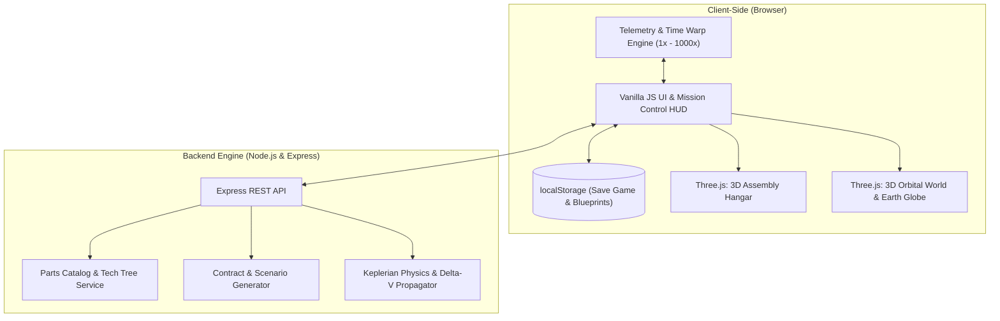

# 🛰️ Orbiterra

**Orbiterra** is an interactive, browser-based 3D Low Earth Orbit (LEO) satellite design and space mission simulation game. Step into the role of an aerospace systems engineer and mission director: design modular satellites within real-world engineering constraints, deploy them into precise orbits around Earth, execute orbital maneuvers, and operate mission constellations to fulfill commercial, scientific, and governmental space contracts.

---

## 🌟 Key Features

- **🛠️ Modular 3D Assembly Hangar**
  - Design satellites ranging from standard CubeSats (1U, 3U, 6U) up to dedicated SmallSat and Heavy LEO buses.
  - Interactive socket snapping with modular subsystems: Power (EPS), Propulsion & ADCS, Communications, Payloads, and Thermal Control (TCS).
  - Real-time engineering budget validation: dry/wet mass, solar generation vs. eclipse battery drain, thermal equilibrium, delta-V, and launch costs.

- **🌍 High-Fidelity 3D Orbital Operations**
  - Photorealistic WebGL Earth globe rendered with Three.js, featuring atmospheric Rayleigh/Mie scattering shaders, specular ocean reflections, and nighttime city lights.
  - Directional solar lighting with dynamic day/night terminator and eclipse shadow calculation.
  - Real-time Keplerian orbit trajectories, sub-satellite ground tracks, and sensor visibility cones.

- **🚀 First-Principles Orbital Mechanics & LEO Regimes**
  - Accurate Keplerian orbital element propagation ($a$, $e$, $i$, $\Omega$, $\omega$, $\nu$).
  - Target four distinct LEO orbital regimes: **Sun-Synchronous (SSO)**, **Polar**, **Equatorial**, and **Mid-Inclination** (e.g., ISS $51.6^\circ$).
  - Execute real orbital maneuvers: Hohmann transfers, plane changes ($\Delta i$), and atmospheric de-orbiting burns.
  - Line-of-sight communications passes over real-world ground station networks (e.g., Svalbard, Goldstone, Madrid, Canberra).

- **⏱️ Time-Warp Simulation Engine**
  - Variable time acceleration: `PAUSE (0x)`, `1x`, `10x`, `60x`, and high-speed `300x` warp with numerical stability.

- **💼 Space Agency Progression & Mission Constraints**
  - Manage all 8 critical mission aspects: Instruments/Payload, Target Orbit, Financial Budget, Mass Budget, Electrical Power (EPS), Data Generation & Storage, Communications Link, and Mission Lifetime.
  - Choose launch providers and spaceports (Rideshare, Dedicated Micro-launcher, Medium-lift) matching latitude and payload requirements.
  - Advance through mission tiers: from amateur CubeSat technology demonstrators to multi-satellite Earth observation and communications constellations.
  - Complete contracts to earn agency credits, build reputation, and unlock cutting-edge aerospace technologies in the Tech Tree.

- **💾 Zero-Database Client Persistence**
  - Complete agency state, blueprints, unlocked technologies, and in-flight missions saved locally in browser `localStorage`.

---

## 🛠️ Tech Stack & Architecture



| Component | Technology | Description |
| :--- | :--- | :--- |
| **Frontend Core** | **HTML5 & Vanilla JavaScript (ES Modules)** | Native DOM-based mission control HUD, reactive telemetry dashboards, and client state management |
| **3D Engine** | **Three.js / WebGL** | Real-time 3D rendering for both the Assembly Hangar and Earth Orbital view |
| **Aesthetic / Styling** | **CSS3 (Custom HUD)** | Dark aerospace theme, glassmorphic panels, neon status telemetry indicators |
| **Backend API** | **Express.js (Node.js)** | REST endpoints for parts catalog, mission contracts, and orbital physics propagation |
| **Persistence** | **`localStorage`** | Local profile, unlocked tech, satellite blueprints, and active mission tracking |

---

## 🛰️ Modular Satellite Subsystems

Every satellite is built around a central chassis (Bus/CDH) with specialized sockets for 6 core subsystems:

```
                  +-----------------------------------+
                  |         Thermal Radiator          |
                  +-----------------+-----------------+
                                    |
+---------------+       +-----------+-----------+       +-------------------+
| Solar Arrays  |<======|   SATELLITE BUS / CDH |======>| Payload (Camera / |
| & EPS Battery |       |  (Core Chassis + OBC) |       | SAR / Comms Dish) |
+---------------+       +-----------+-----------+       +-------------------+
                                    |
                  +-----------------+-----------------+
                  | Propulsion & ADCS (Cold Gas / Ion)|
                  +-----------------------------------+
```

1. **Chassis & On-Board Computer (CDH)**: 1U/3U/6U CubeSat frames, SmallSat buses, and heavy structural frames.
2. **Electrical Power Subsystem (EPS)**: Body-mounted silicon panels, deployable GaAs solar arrays, Li-ion and solid-state batteries.
3. **Propulsion & Attitude Control (ADCS)**: Cold gas thrusters, hydrazine monopropellant, Hall-effect ion thrusters, reaction wheels, and magnetorquers.
4. **Communications (COMMS)**: UHF/VHF omni antennas, S-band patch antennas, X-band dishes, and optical laser terminals.
5. **Payload Equipment**: High-resolution optical cameras, Synthetic Aperture Radar (SAR), atmospheric spectrometers, and IoT/AIS receivers.
6. **Thermal Control System (TCS)**: Passive multi-layer insulation (MLI), heat pipe radiators, and active heaters.

---

## 📁 Repository Structure

```
space-mission-design-game/
├── package.json               # Project manifest and dependencies
├── SPEC.md                    # Comprehensive engineering specification
├── README.md                  # Project overview & documentation
├── server/                    # Node.js Express backend
│   ├── server.js              # Server entry point & middleware
│   ├── routes/                # API route handlers
│   │   ├── catalog.js         # Parts catalog and chassis definitions
│   │   ├── missions.js        # Mission contract generation
│   │   └── physics.js         # Propagation & orbital maneuver endpoints
│   ├── data/                  # Static component specs & ground station lists
│   └── physics/               # Keplerian solvers, delta-V & thermal formulas
└── client/                    # Frontend (HTML5, CSS3, Vanilla JS & Three.js)
    ├── index.html             # Main entry point & HUD view layouts
    ├── assets/                # Earth textures, normal maps, icons
    ├── css/                   # Aerospace HUD styles & themes
    │   ├── main.css           # Global layout, glassmorphic panels & colors
    │   ├── hangar.css         # Hangar turntable & parts tray overlays
    │   └── orbit.css          # Orbit HUD, telemetry dials & burn planner
    └── js/                    # Vanilla JavaScript modules (ES Modules)
        ├── main.js            # App bootstrap, view switching, event hub
        ├── state.js           # State management & localStorage sync
        ├── api.js             # Client for Express REST endpoints
        ├── simulation.js      # Time-warp loop & physics tick runner
        ├── views/             # DOM View controllers
        │   ├── hangarView.js  # Hangar UI controller & socket-snapping
        │   ├── orbitView.js   # Orbit HUD & real-time telemetry gauges
        │   └── contractsView.js # Contracts modal & mission rewards
        ├── three/             # Three.js 3D rendering modules
        │   ├── hangarScene.js # 3D assembly cleanroom & turntable controls
        │   └── orbitScene.js  # 3D Earth, orbit tracks, atmosphere shader
        └── utils/             # Math helpers, orbital constants, vectors
```

---

## 🚀 Getting Started

### Prerequisites

- **Node.js**: v18.0.0 or higher
- **npm**: v9.0.0 or higher

### Installation

1. Clone the repository:
   ```bash
   git clone https://github.com/<your-username>/space-mission-design-game.git
   cd space-mission-design-game
   ```

2. Install dependencies:
   ```bash
   npm install
   ```

3. Launch the development server:
   ```bash
   npm start
   ```

4. Open your browser and navigate to `http://localhost:3000` (or the configured port).

---

## 🔌 API Endpoints (Express Engine)

| Method | Endpoint | Description |
| :--- | :--- | :--- |
| `GET` | `/api/catalog/components` | Returns component catalog, performance stats, mass, and costs |
| `GET` | `/api/catalog/chassis` | Returns available bus frames and socket arrangements |
| `GET` | `/api/missions/contracts` | Returns active, available, and completed mission contracts |
| `POST` | `/api/physics/propagate` | Generates 3D trajectory points and ground tracks from orbital elements |
| `POST` | `/api/physics/maneuver` | Computes required $\Delta v$, fuel mass, and burn times for orbital transfers |
| `POST` | `/api/physics/link-budget` | Computes ground station pass windows and data downlink volume |

---

## 🗺️ Roadmap & Milestones

- [x] **Milestone 1**: System Architecture & Global Specification (`SPEC.md`)
- [ ] **Milestone 2**: Express Backend API & Keplerian Physics Engine
- [ ] **Milestone 3**: 3D Satellite Assembly Hangar (Three.js socket system & engineering validation)
- [ ] **Milestone 4**: 3D Orbital Operations Map (Earth shader, orbit propagation, day/night eclipse, time warp)
- [ ] **Milestone 5**: Space Contracts, Delta-V Maneuvers, Ground Station Downlink & Audio FX

---

## 📄 License

This project is licensed under the [ISC License](LICENSE).
