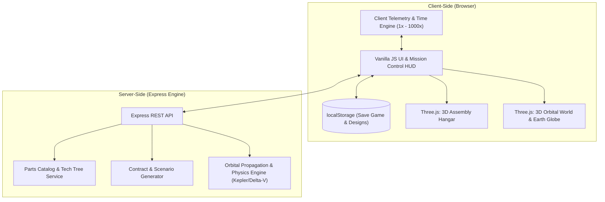
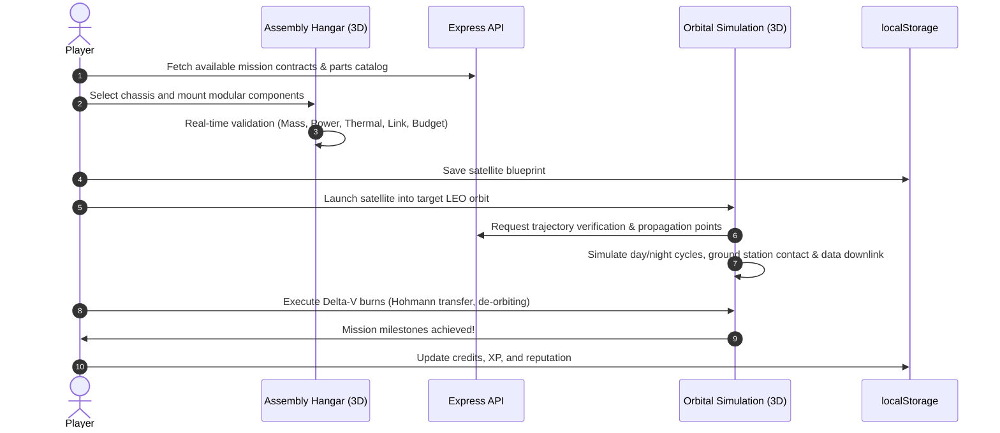

# 🛰️ 3D Low Earth Orbit Satellite Design & Simulation Game
## Global Specification & Architecture Document (`SPEC.md`)

---

## 1. Executive Summary & Project Vision

### 1.1 Overview
The **3D Low Earth Orbit (LEO) Satellite Design & Simulation Game** is an interactive, browser-based space mission engineering game. Players step into the role of a space mission systems engineer and mission director. The objective is to design modular satellites within real-world engineering constraints (mass, volume, power budget, thermal limits, and financial capital), launch them into custom or target Low Earth Orbits (200 km to 2,000 km altitude), execute orbital maneuvers, and operate them to fulfill commercial, scientific, and governmental space mission contracts.

### 1.2 Core Philosophy
- **Realistic Yet Accessible Aerospace Engineering**: Subsystems behave according to first-principle physics approximations (Keplerian orbits, power generation vs. eclipse cycles, thermal dissipation, link budget, and delta-v burn equations) while remaining intuitive and engaging.
- **Dual-View Immersion**: High-fidelity 3D Assembly Hangar for modular satellite building, paired with a 3D Orbital Map featuring a rotating Earth, atmospheric glow, day/night terminator, and real-time ground tracks.
- **Client-Persistent, Server-Assisted**: Express serves as an authoritative scientific engine (catalogs, mission scenarios, complex orbital propagation, and maneuver vectors), while the client maintains all state, unlocks, and designs inside `localStorage`.

---

## 2. Technology Stack & System Architecture



### 2.1 Technology Matrix
| Layer | Technology | Role & Purpose |
| :--- | :--- | :--- |
| **Frontend Core** | **HTML5 & Vanilla JavaScript (ES Modules)** | State management, modular DOM UI components, mission control dashboard, HUD overlays, and contract management without framework overhead. |
| **3D Graphics Engine** | **Three.js** | WebGL rendering for both the 3D Satellite Assembly Hangar (procedural parts, socket snapping, lighting) and the 3D Earth Orbital Environment (textured Earth, atmospheric shader, orbital trajectories, ground stations). |
| **Styling & Theme** | **Vanilla CSS3** | High-performance dark aerospace HUD aesthetics, glassmorphic panels, telemetry dials, neon status indicators, and responsive grid layouts. |
| **Backend Server** | **Express.js (Node.js)** | REST endpoints serving static components catalog, procedural mission generator, delta-v burn calculation, and orbital propagation algorithms. |
| **Persistence** | **Browser `localStorage`** | Zero-database design. Stores player company profile, funds, unlocked technology tree nodes, custom satellite blueprints, active missions, and flight telemetry records. |

---

## 3. Core Gameplay Loops & Progression

### 3.1 Primary Game Loop


### 3.2 Mission Aspects & Core Engineering Constraints

Missions in Orbiterra are governed by eight interrelated engineering constraints and mission parameters that determine mission viability and contract success:

| Aspect / Constraint | Engineering Parameter | Impact & Design Boundary |
| :--- | :--- | :--- |
| **1. Instruments (Payload)** | Sensor type, resolution, duty cycle, field-of-view | Direct driver of mission requirements. Determines data generation rate, operational power draw, and minimum pointing accuracy. |
| **2. Target Orbit** | Altitude ($h$), Inclination ($i$), Eccentricity ($e$), RAAN ($\Omega$) | Dictates thermal profile, eclipse duration, ground station contact windows, coverage swath, and required launch/maneuver $\Delta v$. |
| **3. Financial Budget ($)** | Capital balance, contract advance, milestone payouts | Total satellite hardware cost + launch vehicle procurement must stay within agency funds and contract limits. |
| **4. Mass Budget ($kg$)** | Dry mass, payload mass, propellant mass, wet mass | Limits launch vehicle selection, dictates launch costs, and reduces achievable $\Delta v$ under the Tsiolkovsky equation. |
| **5. Power Budget ($W$, $Wh$)** | Solar generation ($P_{sun}$), battery capacity ($E_{bat}$), eclipse drain | Satellite must maintain positive energy balance over complete orbital day/night cycles to prevent mission-ending blackouts. |
| **6. Data Budget ($MB$, $Gbps$)** | Generation rate, onboard solid-state storage (SSR), downlink quota | Satellites store instrument data in memory until a ground station pass allows downlink. Buffer overflows cause permanent data loss. |
| **7. Communications** | Frequency band (UHF, S, X, Laser), antenna gain, elevation angle ($\epsilon \ge 10^\circ$) | Link budget and ground station visibility cone determine real-time contact duration and maximum achievable downlink volume. |
| **8. Mission Lifetime** | Orbital drag decay, propellant budget, battery cycle life ($DoD$), component MTBF | Defines the operational operational lifespan: ranging from short-duration technology demonstrators (30–90 days) to multi-year constellation satellites (1–5 years). |

### 3.3 Progression System & Tech Tree
- **Mission Tiers**:
  1. **Tier 1 (CubeSat Pioneer)**: 1U/3U CubeSats, simple beacon transmitters, fixed silicon solar panels, basic Earth photography.
  2. **Tier 2 (Commercial Constellations)**: SmallSats (100–300 kg), deployable solar arrays, reaction wheels, magnetorquers, IoT relays, multi-spectral imaging.
  3. **Tier 3 (Advanced LEO Infrastructure)**: Radar (SAR), optical laser communications, Hall-effect ion electric propulsion, active deorbiting tethers, space weather monitoring.

---

## 4. Satellite Subsystems & Modular Components

Every satellite consists of a **Bus (Core Chassis)** with attachment sockets for 6 distinct subsystems:

```
                  +-----------------------------------+
                  |         Thermal Radiator          |
                  +-----------------+-----------------+
                                    |
+---------------+       +-----------+-----------+       +-------------------+
| Solar Arrays  |<======|   SATELLITE BUS / CDH |======>| Payload (Camera / |
| & EPS Battery |       |  (Core Chassis + OBC) |       | SAR / Comms Dish) |
+---------------+       +-----------+-----------+       +-------------------+
                                    |
                  +-----------------+-----------------+
                  | Propulsion & ADCS (Cold Gas / Ion)|
                  +-----------------------------------+
```

### 4.1 Subsystem Specifications

| Subsystem | Components | Key Engineering Metrics |
| :--- | :--- | :--- |
| **1. Bus / Chassis (CDH)** | • 1U CubeSat (10×10×10 cm)<br>• 3U CubeSat (10×10×30 cm)<br>• 6U CubeSat (10×20×30 cm)<br>• SmallSat Bus (50-250 kg)<br>• Heavy LEO Bus (250-1000 kg) | Dry mass, internal component capacity (slots), structural durability, On-Board Computer (OBC) compute power. |
| **2. Electrical Power (EPS)** | • Body-mounted silicon cells<br>• Deployable GaAs solar panels<br>• Li-ion & Solid-state battery packs<br>• Power Distribution Unit (PDU) | Generation wattage ($W_{sun}$), battery capacity ($Wh$), depth of discharge limit, dark eclipse survival duration. |
| **3. Propulsion & ADCS** | • Cold Gas Thruster<br>• Hydrazine Monopropellant<br>• Hall-Effect Ion Thruster<br>• Reaction Wheels & Magnetorquers | Specific Impulse ($I_{sp}$), thrust ($N$), fuel mass ($kg$), delta-v ($\Delta v$), slew rate ($^\circ/s$), attitude pointing accuracy. |
| **4. Communications (COMMS)** | • UHF/VHF Omni Antenna<br>• S-Band Patch Antenna<br>• X-Band High-Gain Dish<br>• Optical Laser Transceiver | Frequency band, data rate (kbps to Gbps), transmission power ($W$), beamwidth, required ground station line-of-sight. |
| **5. Payload (Mission Gear)** | • High-Resolution Optical Imager<br>• Synthetic Aperture Radar (SAR)<br>• Climate & Atmospheric Spectrometer<br>• AIS/IoT Maritime Relay Receiver | Duty cycle power consumption ($W$), data generation rate (MB/orbit), mass, thermal output ($W_{heat}$). |
| **6. Thermal Control (TCS)** | • Multi-Layer Insulation (MLI)<br>• Passive Heat Pipes & Radiator Plates<br>• Active Electric Heaters | Heat dissipation rate ($W$), minimum survival temperature ($-40^\circ\text{C}$), maximum operating temperature ($+65^\circ\text{C}$). |

### 4.2 Engineering Balance Equations
1. **Power Balance**:
   $$\Delta E_{battery} = (P_{generation} - P_{consumption}) \times \Delta t$$
   *During eclipse ($P_{generation} = 0$), battery drains. If $E_{battery} \le 0$, the satellite enters an unrecoverable blackout.*
2. **Delta-V (Tsiolkovsky Rocket Equation)**:
   $$\Delta v = I_{sp} \cdot g_0 \cdot \ln\left(\frac{m_{wet}}{m_{dry}}\right)$$
3. **Thermal Equilibrium**:
   $$Q_{in} (\text{Sun} + \text{Albedo} + \text{Internal}) - Q_{out} (\text{Radiation}) = m \cdot c_p \cdot \frac{dT}{dt}$$
4. **Orbital Lifetime & Drag Decay**:
   $$\frac{da}{dt} \approx - \frac{\rho \cdot v \cdot A \cdot C_d}{m_{wet}} \cdot a$$
   *Below $300\text{ km}$, ballistic decay accelerates rapidly without periodic reboost burns.*

### 4.3 Launch Vehicle Systems & Orbital Insertion

Satellite designs must be paired with an appropriate launch service to reach target LEO deployment orbits:

| Launch Class | Example Providers | Max Payload to LEO | Cost ($) | Orbit Flexibility | Suitable Satellite Form Factors |
| :--- | :--- | :--- | :--- | :--- | :--- |
| **Rideshare / Piggyback** | Transporter rideshares | Up to 50 kg allocation | \$15,000 / kg | Fixed orbit & epoch (usually SSO ~500 km). Fixed schedule. | 1U, 3U, 6U CubeSats |
| **Dedicated Micro-Launcher** | Electron, Firefly Alpha class | Up to 300 kg | \$5,000,000 flat | High flexibility: custom altitude, inclination, and launch window. | 6U CubeSats, SmallSat Buses |
| **Medium-Lift Launcher** | Falcon 9, Ariane 6 class | Up to 15,000 kg | \$25,000,000 flat | Constellation multi-deployment or heavy specialized radar/optical satellites. | Heavy LEO Buses, Multi-Satellite Dispersers |

#### Launch Site Latitude & Inclination Constraints
- **Physics Rule**: Direct launch from a spaceport at latitude $\phi_{site}$ cannot directly inject into an orbital inclination $i < |\phi_{site}|$ without an orbital plane-change maneuver.
- **Supported Spaceports**:
  - **Guiana Space Centre (Kourou)** ($\phi = 5.2^\circ\text{ N}$): Ideal for low-inclination and Equatorial missions with maximum Earth rotation assist ($\sim 460\text{ m/s}$).
  - **Cape Canaveral (USA)** ($\phi = 28.5^\circ\text{ N}$): Standard for mid-inclination missions ($28.5^\circ$ to $51.6^\circ$).
  - **Vandenberg Space Force Base (USA)** ($\phi = 34.7^\circ\text{ N}$) & **Mahia (New Zealand)** ($\phi = 39.2^\circ\text{ S}$): Clear southern trajectories for Polar and Sun-Synchronous (SSO) insertion.

---

## 5. Orbital Mechanics & Physics Engine

The orbital engine focuses on the **Low Earth Orbit (LEO)** domain:
- **Altitude range**: $200\text{ km} \le h \le 2,000\text{ km}$
- **Standard Earth Constants**:
  - Gravitational parameter $\mu = 3.986004418 \times 10^{14}\text{ m}^3/\text{s}^2$
  - Earth mean radius $R_E = 6,371\text{ km}$
  - Standard gravity $g_0 = 9.80665\text{ m/s}^2$

### 5.1 Keplerian Orbital Elements
Each orbit is defined by the standard 6 orbital parameters:
1. **Semi-major axis ($a$)**: $a = R_E + h_{avg}$
2. **Eccentricity ($e$)**: $0 \le e < 0.2$ (typical near-circular LEO)
3. **Inclination ($i$)**: $0^\circ \le i \le 180^\circ$ (Equatorial, ISS-like $51.6^\circ$, Sun-Synchronous $98^\circ$, Polar $90^\circ$)
4. **Longitude of the Ascending Node ($\Omega$)**: $0^\circ \le \Omega < 360^\circ$
5. **Argument of Periapsis ($\omega$)**: $0^\circ \le \omega < 360^\circ$
6. **True Anomaly ($\nu$) or Mean Anomaly ($M$)**: Position along the ellipse at time $t$.

### 5.2 Key Orbital Calculations
- **Orbital Period ($T$)**:
  $$T = 2\pi \sqrt{\frac{a^3}{\mu}}$$
  *(For 400 km ISS orbit, $T \approx 92.6\text{ minutes}$.)*
- **Orbital Speed ($v$)**:
  $$v = \sqrt{\mu \left(\frac{2}{r} - \frac{1}{a}\right)}$$
- **Eclipse / Shadow Function**:
  Computes geometric cylindrical Earth shadow based on Sun position vector $\hat{S}$ and satellite position vector $\vec{r}$.
- **Ground Coverage & Visibility Cone**:
  Half-angle $\theta_{cov}$ determined by altitude and minimum elevation angle ($\epsilon_{min} \approx 10^\circ$).
  Ground stations scattered across realistic global locations (e.g., Svalbard, Goldstone, Madrid, Canberra, Singapore, Kourou).

### 5.3 Orbital Maneuvers
- **Hohmann Transfer**: Two-impulse burn to raise or lower orbital altitude.
- **Plane Change ($\Delta i$)**: High delta-v inclination correction burn.
- **Atmospheric Drag & De-orbiting**: Perigee lowering below 120 km triggers terminal reentry burn-up.

### 5.4 LEO Orbital Regimes & Mission Profiles

The game supports four fundamental Low Earth Orbit regimes, each offering distinct geometric coverage, eclipse behavior, and delta-v requirements:

| Orbit Regime | Typical Inclination ($i$) | Altitude Range ($h$) | Key Characteristics | Optimal Mission Profiles |
| :--- | :--- | :--- | :--- | :--- |
| **1. Sun-Synchronous Orbit (SSO)** | $96^\circ \le i \le 99^\circ$ (Retrograde) | $500\text{ km} - 800\text{ km}$ | Nodal precession equals Earth's orbital period around the Sun ($\approx 0.9856^\circ/\text{day}$). Passes over any given point on Earth at the same local solar mean time. | Optical Earth observation, multispectral imaging, agricultural monitoring, and SAR. |
| **2. Polar Orbit** | $85^\circ \le i \le 95^\circ$ | $400\text{ km} - 1,000\text{ km}$ | Crosses near both poles on every revolution. With Earth rotating beneath, the satellite sweeps across 100% of global surface over time. | Global weather forecasting, climate science, polar ice tracking, and reconnaissance. |
| **3. Equatorial Orbit** | $0^\circ \le i \le 15^\circ$ | $300\text{ km} - 1,200\text{ km}$ | Maximizes Earth rotation launch assist (~460 m/s at Kourou). Extremely frequent revisit rates over tropical and equatorial regions. | Tropical storm monitoring, equatorial broadband communication, and regional IoT/AIS tracking. |
| **4. Mid-Inclination Orbit** | $28^\circ \le i \le 55^\circ$ | $350\text{ km} - 600\text{ km}$ | Covers the most densely populated global latitudes (e.g. ISS orbit at $51.6^\circ$, Cape Canaveral direct injection at $28.5^\circ$). Moderate launch energy. | Commercial communications constellations, Earth resources, scientific research, and crewed station support. |

---

## 6. Client-Server Architecture & API Design

The Express backend serves data and validates orbital math, keeping the client lightweight and reactive.

### 6.1 API Endpoints Specification

| Method | Endpoint | Description | Request Body / Query | Response Payload |
| :--- | :--- | :--- | :--- | :--- |
| `GET` | `/api/catalog/components` | Retrieve complete component catalog, stats, costs, and slot types. | None | `{ categories: [...], parts: [...] }` |
| `GET` | `/api/catalog/chassis` | Retrieve available bus frames and socket layouts. | None | `{ chassis: [...] }` |
| `GET` | `/api/missions/contracts` | List active, available, and completed contract templates. | `?tier=1&reputation=100` | `{ contracts: [...] }` |
| `POST` | `/api/physics/propagate` | Generate discrete orbital state vectors $(x, y, z, v_x, v_y, v_z)$ for $N$ time-steps. | `{ elements: { a, e, i, raan, argP, ma }, duration, step }` | `{ trajectory: [[x,y,z], ...], periods, groundTrack: [...] }` |
| `POST` | `/api/physics/maneuver` | Calculate required $\Delta v$ vector and fuel mass for target orbital transfer. | `{ currentOrbit, targetOrbit, satelliteMass, isp }` | `{ deltaV, burnTime, fuelUsed, intermediateOrbit }` |
| `POST` | `/api/physics/link-budget` | Compute ground station pass windows, contact duration, and transmitted data volume. | `{ orbit, stationId, commsPayload, duration }` | `{ passes: [{ stationId, start, end, dataCapacityMB }] }` |

---

## 7. LocalStorage Persistence Schema

All player progress is serialized into standard JSON keys within browser `localStorage`:

### Key: `leo_game_save_v1`
```json
{
  "player": {
    "agencyName": "AstroDynamics Labs",
    "credits": 250000,
    "reputation": 45,
    "unlockedTech": ["cubesat_3u", "deployable_gaas", "s_band_antenna", "cold_gas_thruster"],
    "stats": {
      "launches": 3,
      "contractsCompleted": 2,
      "satellitesDeorbited": 1
    }
  },
  "blueprints": [
    {
      "id": "bp_earth_obs_01",
      "name": "EagleEye-1",
      "chassisId": "bus_cubesat_3u",
      "slots": {
        "socket_payload": "cam_rgb_hires",
        "socket_power": "solar_deployable_20w",
        "socket_battery": "bat_liion_50wh",
        "socket_propulsion": "prop_coldgas_100ms",
        "socket_comms": "comms_sband_patch",
        "socket_thermal": "tcs_radiator_passive_10w"
      },
      "computedStats": {
        "totalMassKg": 4.2,
        "dryMassKg": 3.6,
        "fuelMassKg": 0.6,
        "cost": 85000,
        "powerBalance": 8.5,
        "deltaV": 92.4
      }
    }
  ],
  "activeMissions": [
    {
      "missionId": "mis_noaa_weather_04",
      "contractId": "contract_earth_obs_polar",
      "satelliteId": "sat_orbiting_eagleeye_1",
      "orbit": {
        "a": 6971,
        "e": 0.0012,
        "i": 97.4,
        "raan": 45.0,
        "argP": 12.0,
        "epoch": 1730592000
      },
      "progress": {
        "dataCollectedMB": 420.5,
        "dataTargetMB": 1000.0,
        "status": "IN_ORBIT"
      }
    }
  ],
  "settings": {
    "musicVolume": 0.7,
    "sfxVolume": 0.9,
    "graphicsQuality": "high",
    "showOrbits": true,
    "showGroundTracks": true
  }
}
```

---

## 8. User Interface & 3D Visualization Specification

### 8.1 Dual-View Experience
The game provides two dedicated 3D canvas viewports with seamless switching:

```
+-----------------------------------------------------------------------------+
| [TOP BAR] Agency: AstroDynamics | Funds: $250,000 | UTC: 2026-11-02 12:00  |
+-----------------------------------------------------------------------------+
| [NAV]  [ 🛠️ Assembly Hangar ]   |   [ 🌍 Orbital Operations ]   |  [ 📋 Missions ]|
+-----------------------------------------------------------------------------+
|                                  |                                          |
|         LEFT CONTROL PANEL       |            THREE.JS 3D VIEWPORT          |
|  - Component Palette (Hangar)    |   • Hangar: 3D Satellite on turntable   |
|  - Orbital Maneuvers (Orbit)     |   • Orbit: 3D Earth, Orbit Path, Sun    |
|  - Live Subsystem Health         |   • Day/Night Terminator, Ground Track   |
|                                  |                                          |
+----------------------------------+------------------------------------------+
| [BOTTOM DOCK] Telemetry Graph / Time Warp (Pause, 1x, 5x, 25x, 100x, 1000x) |
+-----------------------------------------------------------------------------+
```

#### View 1: 3D Satellite Assembly Hangar
- **Turntable Camera**: Orbit controls with smooth damping, zoom bounds, and focus centering.
- **Visual Style**: Clean sci-fi cleanroom / vibration test facility with reflective epoxy floor grid and soft directional studio lighting.
- **Interactive Socket Snapping**: Ghosted 3D wireframe bounding boxes indicate available sockets when dragging or clicking parts.
- **HUD Live Telemetry**: Dynamic gauge meters showing Mass vs. Launch Capacity, Sun Power vs. Eclipse Drain, Thermal Equilibrium, and Total Cost.

#### View 2: 3D Orbital Operations Map
- **Earth Rendering**:
  - High-resolution Earth diffuse texture + specular oceans map + nighttime city lights texture.
  - Atmospheric Rayleigh/Mie scattering glow shader.
  - Directional Sun light source accurately casting real-time day/night terminator.
- **Orbital Visualizations**:
  - Glowing Keplerian ellipse line showing active trajectory.
  - Sub-satellite nadir ground track projected onto Earth surface.
  - Conical footprint indicating instantaneous sensor and communications coverage area.
  - Ground station antennas with pulsing signal arcs during downlink passes.
- **Time Warp Engine**:
  - Speeds: `PAUSE (0x)`, `REALTIME (1x)`, `ORBITAL (10x)`, `FAST (60x)`, `WARP (300x)`.
  - Step-based numerical integration preventing physics tunnel effects at high warp.

### 8.2 Aerospace HUD Aesthetics & Design System
- **Color Palette**:
  - Deep Space Canvas: `#050811` to `#0B132B`
  - Panel Glassmorphism: `rgba(13, 22, 45, 0.75)` with `backdrop-filter: blur(12px)`
  - Cyber Cyan (Primary Accent): `#00F0FF`
  - Neon Amber (Warning/Power): `#FFB703`
  - Solar Gold (EPS Generation): `#FFD166`
  - Matrix Green (Nominal/Success): `#06D6A0`
  - Hazard Red (Eclipse/Blackout/Deorbit): `#EF476F`
- **Typography**: Modern geometric sans-serif (e.g., `Orbitron` / `Space Grotesk` for headers, `Inter` / `JetBrains Mono` for telemetry and numbers).

---

## 9. Error Handling, Safety Limits & Performance

### 9.1 Physics & Space Hazards Safety Boundaries
1. **Perigee Decay**: If satellite altitude dips below $120\text{ km}$, trigger atmospheric drag decay sequence leading to fiery destruction.
2. **Thermal Shock**: If satellite spends $>60\text{ minutes}$ in full shadow without active battery heaters, payload sensors freeze and take permanent efficiency damage.
3. **Power Blackout**: If battery reaches $0\%$ in eclipse, all orientation control is lost until the next orbital sunrise; reaction wheels require manual spin-up recovery.

### 9.2 Rendering & WebGL Optimization
- **Texture Sharing & Memory Disposals**: Explicitly invoke `.dispose()` on geometries, materials, and textures when switching between Hangar and Orbit modes.
- **LOD (Level of Detail)**: Scale down Earth sphere segment count from 64x64 on desktop to 32x32 if framerate drops below 45 FPS.
- **Instanced Meshes**: Used for stars skybox and debris fields.

---

## 10. File & Directory Structure

```
space-mission-design-game/
├── package.json
├── SPEC.md                           # This global specification
├── server/
│   ├── server.js                     # Express entry point & middleware
│   ├── routes/
│   │   ├── catalog.js                # Parts and chassis endpoints
│   │   ├── missions.js               # Contract generation & rewards
│   │   └── physics.js                # Propagation & delta-v endpoints
│   ├── data/
│   │   ├── components.json           # Catalog of bus, solar, thrusters, payloads
│   │   └── groundStations.json       # Real-world ground station lat/lon coordinates
│   └── physics/
│       ├── kepler.js                 # Keplerian equations, anomalies & state vectors
│       ├── maneuvers.js              # Hohmann transfer & delta-v calculators
│       └── thermal.js                # Solar flux, eclipse & heat dissipation
├── client/
│   ├── index.html                    # Main entry point & HUD view layouts
│   ├── assets/                       # Earth textures, normal maps, decals, icons
│   ├── css/                          # Aerospace HUD styling & glassmorphism
│   │   ├── main.css                  # Layout, typography, global palette
│   │   ├── hangar.css                # 3D turntable overlay & parts tray
│   │   └── orbit.css                 # Telemetry HUD, burn planner, warp dock
│   └── js/                           # Vanilla JavaScript (ES Modules)
│       ├── main.js                   # Application bootstrap, navigation & routing
│       ├── state.js                  # Centralized state & localStorage sync
│       ├── api.js                    # Fetch client for Express REST API
│       ├── simulation.js             # Real-time tick engine & time-warp runner
│       ├── views/                    # DOM UI View Controllers
│       │   ├── hangarView.js         # Assembly hangar UI & socket-snapping
│       │   ├── orbitView.js          # Orbital operations HUD & telemetry dials
│       │   └── contractsView.js      # Contracts management & reward dialogs
│       ├── three/                    # Three.js 3D Viewports
│       │   ├── hangarScene.js        # Assembly cleanroom & turntable controls
│       │   └── orbitScene.js         # Earth globe, trajectory line, atmosphere shader
│       └── utils/                    # Shared utilities
│           ├── math.js               # Coordinate conversions & vector arithmetic
│           └── constants.js          # Astrodynamic constants (R_EARTH, MU, etc.)
```

---

## 11. Phased Development Roadmap

### Phase 1: Core Foundation & Systems (M1)
- [x] Global Specification Document (`SPEC.md`).
- [ ] Express backend with `/api/catalog` and `/api/physics/propagate`.
- [ ] Vanilla JS application scaffold with aerospace UI design system.
- [ ] `localStorage` save system schema implementation.

### Phase 2: 3D Assembly Hangar (M2)
- [ ] Three.js assembly hangar scene with procedural or composite 3D satellite components.
- [ ] Component drag/click slot-snapping system.
- [ ] Real-time mass, power, thermal, and cost recalculation engine.

### Phase 3: 3D Orbital World & Flight Dynamics (M3)
- [ ] Three.js textured Earth globe with atmospheric glow and rotating directional Sun.
- [ ] Real-time orbit line rendering and satellite position updating via Kepler equations.
- [ ] Day/Night eclipse detection and battery charging/discharging loop.
- [ ] Time warp controls (Pause, 1x, 10x, 100x, 1000x).

### Phase 4: Contracts, Maneuvers & Downlink (M4)
- [ ] Ground stations line-of-sight cone and telemetry data downlink.
- [ ] Hohmann transfer burn execution and delta-v expenditure.
- [ ] Contract fulfillment, financial payouts, and tech tree unlocks.

### Phase 5: Audio, Polish & Performance (M5)
- [ ] Sound effects (thruster hisses, telemetry beeps, UI clicks).
- [ ] Deorbit burn fire VFX and satellite destruction animations.
- [ ] Performance benchmarking and final UX polish.

### 8.3 Guided Assembly Preview (2026-11-06)

The mission brief opens a guided assembly preview before the full 3D hangar milestone.
- Keep a large 3D satellite viewer on the left and one active subsystem's component choices on the right. Place expandable mass, power and budget estimates in a compact bottom bar; retain mission performance in design review and payload descriptions.
- Provide contextual Continue actions through Chassis, Payload, Power and Systems; the final action opens design review. Keep saving secondary in the header and reset inside View options with confirmation.
- Read beginner components from the existing catalog API. Allow one component per subsystem, filter by chassis family, and remove incompatible selections when changing chassis.
- Save preview blueprints in the existing blueprints array, preserving other save fields. Hardware cost is an estimate and does not deduct player credits.
- Show nominal catalog imaging performance and ideal sunlight power estimates. Clearly label unimplemented slot, thermal, eclipse, pointing and downlink checks. The review must not unlock launch or imply complete flight validation.
- Use a responsive layout with stacked panels on small screens. A Three.js workbench renders installed components and isolated part previews. Physical socket placement remains Phase 2 work.

#### Assembly studio refinements
- Group six core selections into four stages: Chassis, Payload, Power (solar/battery), and Systems (communications/computer plus optional thermal/propulsion). Show current stage and selection completion without implying flight readiness.
- Component cards compare configured mass, key catalog performance, and projected hardware cost. Chassis replacement projections exclude incompatible parts that will be removed; explain that removal before selection and report it afterward.
- Resume the first missing core selection, preserve keyboard focus and metric disclosures through updates, and reflect installed parts in preview shortcuts. Restrict Urban Mapping's payload picker to optical instruments.
- Use muted charcoal surfaces with gold primary guidance, sage selection indicators, and warm warning text. Mobile layouts show a compact 3D preview above the component panel and avoid nested component scrolling.

#### Interactive 3D workbench
- Use the existing vendored Three.js modules and local procedural geometry, without network model dependencies. Build component-specific PBR models from catalog dimensions: chassis rails, solar cells, optical lenses, battery cells, antennas, circuit boards, thermal panels, attitude actuators and thrusters.
- Render installed selections together. Each component card offers an isolated “Preview in 3D”; previewing must not change the blueprint, cost or selection progress. Install from the card or the preview toolbar and return to the assembly.
- Support pointer/touch rotation, pinch/wheel/button zoom, arrow-key rotation, keyboard zoom, camera reset, internal-component transparency, wireframe and exploded assembly views. Clicking installed geometry selects its subsystem.
- Render on demand, suspend the hidden menu scene during assembly, share one workbench renderer across part previews, and dispose replaced geometry/materials and the renderer on page exit. Resize for desktop/mobile and retain non-3D component selection if WebGL is unavailable.
- Mounting locations are illustrative and do not implement collision, slot occupancy or physical fit validation. The catalog's progression/compatibility filters still determine which parts the player can select.

#### Satellite silhouette and inspection defaults
- Default to a closed, opaque spacecraft; cutaway and exploded views are deliberate inspection options. Keep structural rails opaque during cutaway.
- Align the chassis upright and visually contain internal modules. Camera apertures may protrude through the front face; antennas and nozzles attach to their relevant faces.
- Depict a deployed catalog solar array as a connected, symmetric pair of half-width wings, preserving its total represented panel area and all catalog engineering totals. Keep body-mounted arrays attached to the hull.
- Fit the camera to projected model bounds so the assembly fills the workbench without cropping. These visual accommodations do not claim validated physical slot fit.

#### Attachment continuity
- Align each deployable wing's hinge with its inner edge and show visible support arms that overlap the hull and panel geometry.
- Position exterior mounts against actual rendered geometry where nominal dimensions do not describe the base. Body solar, communications, thermal and propulsion components require continuous support brackets.
- Label exploded inspection explicitly and provide a direct “Reattach parts” action. Exploded separation must not be mistaken for the default installed arrangement.

#### Stable workbench viewport
- Allocate explicit grid areas for the viewer and its controls. Decorative rings must stay within panel bounds and must not create scrollable content.
- The 3D stage itself must not scroll, including when component preview or inspection tools are used. Keep the canvas fitted to its allocated viewer area and desktop scrolling inside the component library.
- Show inspection settings in a bounded popover that preserves viewer height and supports outside-click/Escape dismissal without intercepting modal-dialog dismissal.

#### Camera continuity and interaction feedback
- Preserve assembly rotation and normalized zoom across category changes, component updates and viewport resizing. Remember isolated previews separately and restore the assembly view when returning. Reset View is the explicit reset action; newly sized models may refit without discarding the user's rotation/zoom preference.
- Avoid rebuilding unchanged model geometry for navigation-only updates. Keep animation demand-driven and restore material state when an effect completes or is interrupted.
- Installation/removal must produce a short accessible confirmation. Installed parts receive a brief fade/highlight; selected cards stay first and have clear badges with quieter removal controls.
- Show an Assembly / Part preview / Exploded view mode indicator. Use short 150–200 ms UI transitions without layout shifts. Reduced-motion mode must retain textual feedback while suppressing animation and canceling effects already running.
