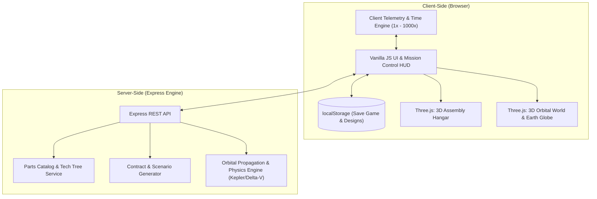
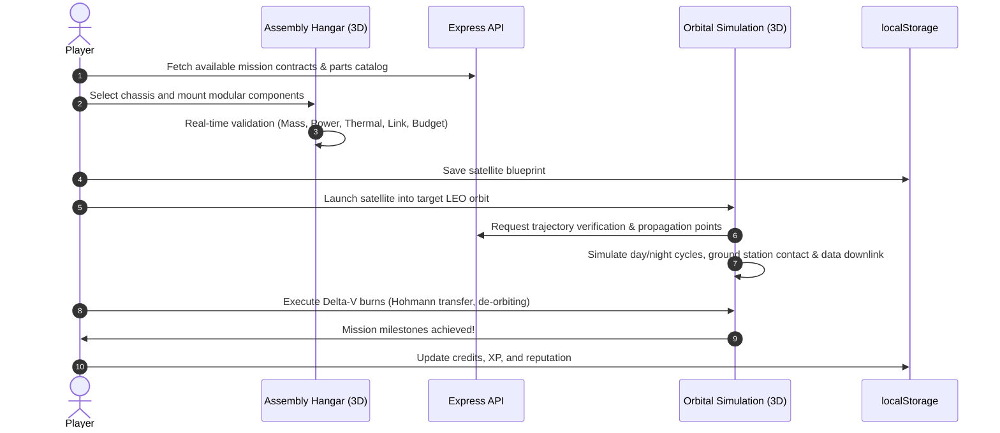

# 🛰️ 3D Low Earth Orbit Satellite Design & Simulation Game
## Global Specification & Architecture Document (`SPEC.md`)

---

## 1. Executive Summary & Project Vision

### 1.1 Overview
The **3D Low Earth Orbit (LEO) Satellite Design & Simulation Game** is an interactive, browser-based space mission engineering game. Players step into the role of a space mission systems engineer and mission director. The objective is to design modular satellites within real-world engineering constraints (mass, volume, power budget, thermal limits, and financial capital), launch them into custom or target Low Earth Orbits (200 km to 2,000 km altitude), execute orbital maneuvers, and operate them to fulfill commercial, scientific, and governmental space mission contracts.

### 1.2 Core Philosophy
- **Realistic Yet Accessible Aerospace Engineering**: Subsystems behave according to first-principle physics approximations (Keplerian orbits, power generation vs. eclipse cycles, thermal dissipation, link budget, and delta-v burn equations) while remaining intuitive and engaging.
- **Dual-View Immersion**: High-fidelity 3D Assembly Hangar for modular satellite building, paired with a 3D Orbital Map featuring a rotating Earth, atmospheric glow, day/night terminator, and real-time ground tracks.
- **Client-Persistent, Server-Assisted**: Express serves as an authoritative scientific engine (catalogs, mission scenarios, complex orbital propagation, and maneuver vectors), while the client maintains all state, unlocks, and designs inside `localStorage`.

---

## 2. Technology Stack & System Architecture



### 2.1 Technology Matrix
| Layer | Technology | Role & Purpose |
| :--- | :--- | :--- |
| **Frontend Core** | **HTML5 & Vanilla JavaScript (ES Modules)** | State management, modular DOM UI components, mission control dashboard, HUD overlays, and contract management without framework overhead. |
| **3D Graphics Engine** | **Three.js** | WebGL rendering for both the 3D Satellite Assembly Hangar (procedural parts, socket snapping, lighting) and the 3D Earth Orbital Environment (textured Earth, atmospheric shader, orbital trajectories, ground stations). |
| **Styling & Theme** | **Vanilla CSS3** | High-performance dark aerospace HUD aesthetics, glassmorphic panels, telemetry dials, neon status indicators, and responsive grid layouts. |
| **Backend Server** | **Express.js (Node.js)** | REST endpoints serving static components catalog, procedural mission generator, delta-v burn calculation, and orbital propagation algorithms. |
| **Persistence** | **Browser `localStorage`** | Zero-database design. Stores player company profile, funds, unlocked technology tree nodes, custom satellite blueprints, active missions, and flight telemetry records. |

---

## 3. Core Gameplay Loops & Progression

### 3.1 Primary Game Loop


### 3.2 Progression System & Tech Tree
- **Mission Tiers**:
  1. **Tier 1 (CubeSat Pioneer)**: 1U/3U CubeSats, simple beacon transmitters, fixed solar panels, basic Earth photography.
  2. **Tier 2 (Commercial Constellations)**: SmallSats (100–300 kg), deployable solar arrays, reaction wheels, magnetorquers, IoT relays, multi-spectral imaging.
  3. **Tier 3 (Advanced LEO Infrastructure)**: Radar (SAR), optical communications, ion electric propulsion, active deorbiting tethers, space weather monitoring.
- **Resource Constraints**:
  - **Financial Budget ($)**: Launch cost + component manufacturing costs must not exceed contract advance and player balance.
  - **Mass (kg)**: Direct impact on launch vehicle pricing and delta-v burn capacity.
  - **Volume / Form Factor**: Slots restricted by chassis size (1U, 3U, 6U, SmallSat Bus, ESPA-class).

---

## 4. Satellite Subsystems & Modular Components

Every satellite consists of a **Bus (Core Chassis)** with attachment sockets for 6 distinct subsystems:

```
                  +-----------------------------------+
                  |         Thermal Radiator          |
                  +-----------------+-----------------+
                                    |
+---------------+       +-----------+-----------+       +-------------------+
| Solar Arrays  |<======|   SATELLITE BUS / CDH |======>| Payload (Camera / |
| & EPS Battery |       |  (Core Chassis + OBC) |       | SAR / Comms Dish) |
+---------------+       +-----------+-----------+       +-------------------+
                                    |
                  +-----------------+-----------------+
                  | Propulsion & ADCS (Cold Gas / Ion)|
                  +-----------------------------------+
```

### 4.1 Subsystem Specifications

| Subsystem | Components | Key Engineering Metrics |
| :--- | :--- | :--- |
| **1. Bus / Chassis (CDH)** | • 1U CubeSat (10×10×10 cm)<br>• 3U CubeSat (10×10×30 cm)<br>• 6U CubeSat (10×20×30 cm)<br>• SmallSat Bus (50-250 kg)<br>• Heavy LEO Bus (250-1000 kg) | Dry mass, internal component capacity (slots), structural durability, On-Board Computer (OBC) compute power. |
| **2. Electrical Power (EPS)** | • Body-mounted silicon cells<br>• Deployable GaAs solar panels<br>• Li-ion & Solid-state battery packs<br>• Power Distribution Unit (PDU) | Generation wattage ($W_{sun}$), battery capacity ($Wh$), depth of discharge limit, dark eclipse survival duration. |
| **3. Propulsion & ADCS** | • Cold Gas Thruster<br>• Hydrazine Monopropellant<br>• Hall-Effect Ion Thruster<br>• Reaction Wheels & Magnetorquers | Specific Impulse ($I_{sp}$), thrust ($N$), fuel mass ($kg$), delta-v ($\Delta v$), slew rate ($^\circ/s$), attitude pointing accuracy. |
| **4. Communications (COMMS)** | • UHF/VHF Omni Antenna<br>• S-Band Patch Antenna<br>• X-Band High-Gain Dish<br>• Optical Laser Transceiver | Frequency band, data rate (kbps to Gbps), transmission power ($W$), beamwidth, required ground station line-of-sight. |
| **5. Payload (Mission Gear)** | • High-Resolution Optical Imager<br>• Synthetic Aperture Radar (SAR)<br>• Climate & Atmospheric Spectrometer<br>• AIS/IoT Maritime Relay Receiver | Duty cycle power consumption ($W$), data generation rate (MB/orbit), mass, thermal output ($W_{heat}$). |
| **6. Thermal Control (TCS)** | • Multi-Layer Insulation (MLI)<br>• Passive Heat Pipes & Radiator Plates<br>• Active Electric Heaters | Heat dissipation rate ($W$), minimum survival temperature ($-40^\circ\text{C}$), maximum operating temperature ($+65^\circ\text{C}$). |

### 4.2 Engineering Balance Equations
1. **Power Balance**:
   $$\Delta E_{battery} = (P_{generation} - P_{consumption}) \times \Delta t$$
   *During eclipse ($P_{generation} = 0$), battery drains. If $E_{battery} \le 0$, the satellite enters an unrecoverable blackout.*
2. **Delta-V (Tsiolkovsky Rocket Equation)**:
   $$\Delta v = I_{sp} \cdot g_0 \cdot \ln\left(\frac{m_{wet}}{m_{dry}}\right)$$
3. **Thermal Equilibrium**:
   $$Q_{in} (\text{Sun} + \text{Albedo} + \text{Internal}) - Q_{out} (\text{Radiation}) = m \cdot c_p \cdot \frac{dT}{dt}$$

---

## 5. Orbital Mechanics & Physics Engine

The orbital engine focuses on the **Low Earth Orbit (LEO)** domain:
- **Altitude range**: $200\text{ km} \le h \le 2,000\text{ km}$
- **Standard Earth Constants**:
  - Gravitational parameter $\mu = 3.986004418 \times 10^{14}\text{ m}^3/\text{s}^2$
  - Earth mean radius $R_E = 6,371\text{ km}$
  - Standard gravity $g_0 = 9.80665\text{ m/s}^2$

### 5.1 Keplerian Orbital Elements
Each orbit is defined by the standard 6 orbital parameters:
1. **Semi-major axis ($a$)**: $a = R_E + h_{avg}$
2. **Eccentricity ($e$)**: $0 \le e < 0.2$ (typical near-circular LEO)
3. **Inclination ($i$)**: $0^\circ \le i \le 180^\circ$ (Equatorial, ISS-like $51.6^\circ$, Sun-Synchronous $98^\circ$, Polar $90^\circ$)
4. **Longitude of the Ascending Node ($\Omega$)**: $0^\circ \le \Omega < 360^\circ$
5. **Argument of Periapsis ($\omega$)**: $0^\circ \le \omega < 360^\circ$
6. **True Anomaly ($\nu$) or Mean Anomaly ($M$)**: Position along the ellipse at time $t$.

### 5.2 Key Orbital Calculations
- **Orbital Period ($T$)**:
  $$T = 2\pi \sqrt{\frac{a^3}{\mu}}$$
  *(For 400 km ISS orbit, $T \approx 92.6\text{ minutes}$.)*
- **Orbital Speed ($v$)**:
  $$v = \sqrt{\mu \left(\frac{2}{r} - \frac{1}{a}\right)}$$
- **Eclipse / Shadow Function**:
  Computes geometric cylindrical Earth shadow based on Sun position vector $\hat{S}$ and satellite position vector $\vec{r}$.
- **Ground Coverage & Visibility Cone**:
  Half-angle $\theta_{cov}$ determined by altitude and minimum elevation angle ($\epsilon_{min} \approx 10^\circ$).
  Ground stations scattered across realistic global locations (e.g., Svalbard, Goldstone, Madrid, Canberra, Singapore, Kourou).

### 5.3 Orbital Maneuvers
- **Hohmann Transfer**: Two-impulse burn to raise or lower orbital altitude.
- **Plane Change ($\Delta i$)**: High delta-v inclination correction burn.
- **Atmospheric Drag & De-orbiting**: Perigee lowering below 120 km triggers terminal reentry burn-up.

---

## 6. Client-Server Architecture & API Design

The Express backend serves data and validates orbital math, keeping the client lightweight and reactive.

### 6.1 API Endpoints Specification

| Method | Endpoint | Description | Request Body / Query | Response Payload |
| :--- | :--- | :--- | :--- | :--- |
| `GET` | `/api/catalog/components` | Retrieve complete component catalog, stats, costs, and slot types. | None | `{ categories: [...], parts: [...] }` |
| `GET` | `/api/catalog/chassis` | Retrieve available bus frames and socket layouts. | None | `{ chassis: [...] }` |
| `GET` | `/api/missions/contracts` | List active, available, and completed contract templates. | `?tier=1&reputation=100` | `{ contracts: [...] }` |
| `POST` | `/api/physics/propagate` | Generate discrete orbital state vectors $(x, y, z, v_x, v_y, v_z)$ for $N$ time-steps. | `{ elements: { a, e, i, raan, argP, ma }, duration, step }` | `{ trajectory: [[x,y,z], ...], periods, groundTrack: [...] }` |
| `POST` | `/api/physics/maneuver` | Calculate required $\Delta v$ vector and fuel mass for target orbital transfer. | `{ currentOrbit, targetOrbit, satelliteMass, isp }` | `{ deltaV, burnTime, fuelUsed, intermediateOrbit }` |
| `POST` | `/api/physics/link-budget` | Compute ground station pass windows, contact duration, and transmitted data volume. | `{ orbit, stationId, commsPayload, duration }` | `{ passes: [{ stationId, start, end, dataCapacityMB }] }` |

---

## 7. LocalStorage Persistence Schema

All player progress is serialized into standard JSON keys within browser `localStorage`:

### Key: `leo_game_save_v1`
```json
{
  "player": {
    "agencyName": "AstroDynamics Labs",
    "credits": 250000,
    "reputation": 45,
    "unlockedTech": ["cubesat_3u", "deployable_gaas", "s_band_antenna", "cold_gas_thruster"],
    "stats": {
      "launches": 3,
      "contractsCompleted": 2,
      "satellitesDeorbited": 1
    }
  },
  "blueprints": [
    {
      "id": "bp_earth_obs_01",
      "name": "EagleEye-1",
      "chassisId": "bus_cubesat_3u",
      "slots": {
        "socket_payload": "cam_rgb_hires",
        "socket_power": "solar_deployable_20w",
        "socket_battery": "bat_liion_50wh",
        "socket_propulsion": "prop_coldgas_100ms",
        "socket_comms": "comms_sband_patch",
        "socket_thermal": "tcs_radiator_passive_10w"
      },
      "computedStats": {
        "totalMassKg": 4.2,
        "dryMassKg": 3.6,
        "fuelMassKg": 0.6,
        "cost": 85000,
        "powerBalance": 8.5,
        "deltaV": 92.4
      }
    }
  ],
  "activeMissions": [
    {
      "missionId": "mis_noaa_weather_04",
      "contractId": "contract_earth_obs_polar",
      "satelliteId": "sat_orbiting_eagleeye_1",
      "orbit": {
        "a": 6971,
        "e": 0.0012,
        "i": 97.4,
        "raan": 45.0,
        "argP": 12.0,
        "epoch": 1730592000
      },
      "progress": {
        "dataCollectedMB": 420.5,
        "dataTargetMB": 1000.0,
        "status": "IN_ORBIT"
      }
    }
  ],
  "settings": {
    "musicVolume": 0.7,
    "sfxVolume": 0.9,
    "graphicsQuality": "high",
    "showOrbits": true,
    "showGroundTracks": true
  }
}
```

---

## 8. User Interface & 3D Visualization Specification

### 8.1 Dual-View Experience
The game provides two dedicated 3D canvas viewports with seamless switching:

```
+-----------------------------------------------------------------------------+
| [TOP BAR] Agency: AstroDynamics | Funds: $250,000 | UTC: 2026-11-02 12:00  |
+-----------------------------------------------------------------------------+
| [NAV]  [ 🛠️ Assembly Hangar ]   |   [ 🌍 Orbital Operations ]   |  [ 📋 Missions ]|
+-----------------------------------------------------------------------------+
|                                  |                                          |
|         LEFT CONTROL PANEL       |            THREE.JS 3D VIEWPORT          |
|  - Component Palette (Hangar)    |   • Hangar: 3D Satellite on turntable   |
|  - Orbital Maneuvers (Orbit)     |   • Orbit: 3D Earth, Orbit Path, Sun    |
|  - Live Subsystem Health         |   • Day/Night Terminator, Ground Track   |
|                                  |                                          |
+----------------------------------+------------------------------------------+
| [BOTTOM DOCK] Telemetry Graph / Time Warp (Pause, 1x, 5x, 25x, 100x, 1000x) |
+-----------------------------------------------------------------------------+
```

#### View 1: 3D Satellite Assembly Hangar
- **Turntable Camera**: Orbit controls with smooth damping, zoom bounds, and focus centering.
- **Visual Style**: Clean sci-fi cleanroom / vibration test facility with reflective epoxy floor grid and soft directional studio lighting.
- **Interactive Socket Snapping**: Ghosted 3D wireframe bounding boxes indicate available sockets when dragging or clicking parts.
- **HUD Live Telemetry**: Dynamic gauge meters showing Mass vs. Launch Capacity, Sun Power vs. Eclipse Drain, Thermal Equilibrium, and Total Cost.

#### View 2: 3D Orbital Operations Map
- **Earth Rendering**:
  - High-resolution Earth diffuse texture + specular oceans map + nighttime city lights texture.
  - Atmospheric Rayleigh/Mie scattering glow shader.
  - Directional Sun light source accurately casting real-time day/night terminator.
- **Orbital Visualizations**:
  - Glowing Keplerian ellipse line showing active trajectory.
  - Sub-satellite nadir ground track projected onto Earth surface.
  - Conical footprint indicating instantaneous sensor and communications coverage area.
  - Ground station antennas with pulsing signal arcs during downlink passes.
- **Time Warp Engine**:
  - Speeds: `PAUSE (0x)`, `REALTIME (1x)`, `ORBITAL (10x)`, `FAST (60x)`, `WARP (300x)`.
  - Step-based numerical integration preventing physics tunnel effects at high warp.

### 8.2 Aerospace HUD Aesthetics & Design System
- **Color Palette**:
  - Deep Space Canvas: `#050811` to `#0B132B`
  - Panel Glassmorphism: `rgba(13, 22, 45, 0.75)` with `backdrop-filter: blur(12px)`
  - Cyber Cyan (Primary Accent): `#00F0FF`
  - Neon Amber (Warning/Power): `#FFB703`
  - Solar Gold (EPS Generation): `#FFD166`
  - Matrix Green (Nominal/Success): `#06D6A0`
  - Hazard Red (Eclipse/Blackout/Deorbit): `#EF476F`
- **Typography**: Modern geometric sans-serif (e.g., `Orbitron` / `Space Grotesk` for headers, `Inter` / `JetBrains Mono` for telemetry and numbers).

---

## 9. Error Handling, Safety Limits & Performance

### 9.1 Physics & Space Hazards Safety Boundaries
1. **Perigee Decay**: If satellite altitude dips below $120\text{ km}$, trigger atmospheric drag decay sequence leading to fiery destruction.
2. **Thermal Shock**: If satellite spends $>60\text{ minutes}$ in full shadow without active battery heaters, payload sensors freeze and take permanent efficiency damage.
3. **Power Blackout**: If battery reaches $0\%$ in eclipse, all orientation control is lost until the next orbital sunrise; reaction wheels require manual spin-up recovery.

### 9.2 Rendering & WebGL Optimization
- **Texture Sharing & Memory Disposals**: Explicitly invoke `.dispose()` on geometries, materials, and textures when switching between Hangar and Orbit modes.
- **LOD (Level of Detail)**: Scale down Earth sphere segment count from 64x64 on desktop to 32x32 if framerate drops below 45 FPS.
- **Instanced Meshes**: Used for stars skybox and debris fields.

---

## 10. File & Directory Structure

```
space-mission-design-game/
├── package.json
├── SPEC.md                           # This global specification
├── server/
│   ├── server.js                     # Express entry point & middleware
│   ├── routes/
│   │   ├── catalog.js                # Parts and chassis endpoints
│   │   ├── missions.js               # Contract generation & rewards
│   │   └── physics.js                # Propagation & delta-v endpoints
│   ├── data/
│   │   ├── components.json           # Catalog of bus, solar, thrusters, payloads
│   │   └── groundStations.json       # Real-world ground station lat/lon coordinates
│   └── physics/
│       ├── kepler.js                 # Keplerian equations, anomalies & state vectors
│       ├── maneuvers.js              # Hohmann transfer & delta-v calculators
│       └── thermal.js                # Solar flux, eclipse & heat dissipation
├── client/
│   ├── index.html                    # Main entry point & HUD view layouts
│   ├── assets/                       # Earth textures, normal maps, decals, icons
│   ├── css/                          # Aerospace HUD styling & glassmorphism
│   │   ├── main.css                  # Layout, typography, global palette
│   │   ├── hangar.css                # 3D turntable overlay & parts tray
│   │   └── orbit.css                 # Telemetry HUD, burn planner, warp dock
│   └── js/                           # Vanilla JavaScript (ES Modules)
│       ├── main.js                   # Application bootstrap, navigation & routing
│       ├── state.js                  # Centralized state & localStorage sync
│       ├── api.js                    # Fetch client for Express REST API
│       ├── simulation.js             # Real-time tick engine & time-warp runner
│       ├── views/                    # DOM UI View Controllers
│       │   ├── hangarView.js         # Assembly hangar UI & socket-snapping
│       │   ├── orbitView.js          # Orbital operations HUD & telemetry dials
│       │   └── contractsView.js      # Contracts management & reward dialogs
│       ├── three/                    # Three.js 3D Viewports
│       │   ├── hangarScene.js        # Assembly cleanroom & turntable controls
│       │   └── orbitScene.js         # Earth globe, trajectory line, atmosphere shader
│       └── utils/                    # Shared utilities
│           ├── math.js               # Coordinate conversions & vector arithmetic
│           └── constants.js          # Astrodynamic constants (R_EARTH, MU, etc.)
```

---

## 11. Phased Development Roadmap

### Phase 1: Core Foundation & Systems (M1)
- [x] Global Specification Document (`SPEC.md`).
- [ ] Express backend with `/api/catalog` and `/api/physics/propagate`.
- [ ] Vanilla JS application scaffold with aerospace UI design system.
- [ ] `localStorage` save system schema implementation.

### Phase 2: 3D Assembly Hangar (M2)
- [ ] Three.js assembly hangar scene with procedural or composite 3D satellite components.
- [ ] Component drag/click slot-snapping system.
- [ ] Real-time mass, power, thermal, and cost recalculation engine.

### Phase 3: 3D Orbital World & Flight Dynamics (M3)
- [ ] Three.js textured Earth globe with atmospheric glow and rotating directional Sun.
- [ ] Real-time orbit line rendering and satellite position updating via Kepler equations.
- [ ] Day/Night eclipse detection and battery charging/discharging loop.
- [ ] Time warp controls (Pause, 1x, 10x, 100x, 1000x).

### Phase 4: Contracts, Maneuvers & Downlink (M4)
- [ ] Ground stations line-of-sight cone and telemetry data downlink.
- [ ] Hohmann transfer burn execution and delta-v expenditure.
- [ ] Contract fulfillment, financial payouts, and tech tree unlocks.

### Phase 5: Audio, Polish & Performance (M5)
- [ ] Sound effects (thruster hisses, telemetry beeps, UI clicks).
- [ ] Deorbit burn fire VFX and satellite destruction animations.
- [ ] Performance benchmarking and final UX polish.
